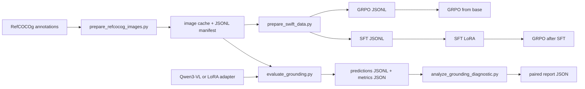
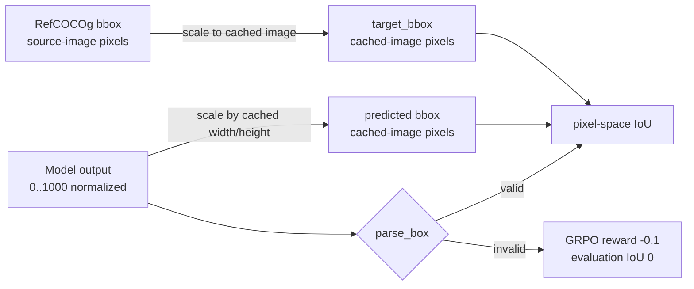

# RefCOCOg VLM Grounding

Research code for evaluating and improving Qwen3-VL on 2D referring-expression
grounding. The repository keeps the reusable geometry and reward logic small,
then puts dataset preparation, evaluation, diagnostics, and HPC training in
explicit command-line entry points.

> [!IMPORTANT]
> This is experiment code, not a packaged training framework. Images, model
> caches, checkpoints, manifests, and results live outside Git. The checked-in
> Slurm launcher assumes the shared HPC layout described below.

## The short version

| Area | Current contract |
| --- | --- |
| Dataset | `jxu124/refcocog`, loaded by the preparation script and notebooks |
| Model default | `Qwen/Qwen3-VL-8B-Instruct` |
| Training | ms-swift LoRA SFT, GRPO from the base model, or GRPO after SFT |
| Prediction format | One normalized `[x1, y1, x2, y2]` box on a `0..1000` image-relative scale |
| Main metrics | Mean IoU, Acc@0.5, Acc@0.75, and parse failures |
| Diagnostic metrics | Predicted/ground-truth area ratio, center distance, and paired deltas |
| HPC root | `/scratch/ambpdc/soham/vlm` in `slurm/train_ablation.sh` |

## End-to-end map



The normal order is:

1. Cache only the images needed for the selected split and write a manifest.
2. Convert that manifest into the ms-swift GRPO and SFT JSONL formats.
3. Run SFT and/or GRPO on the HPC cluster.
4. Evaluate every model on the same manifest.
5. Compare predictions by reference ID and split with the paired diagnostic.

## Coordinate and reward contract

The repository intentionally uses two coordinate spaces. Keeping them separate
prevents a resized cached image from silently changing the annotation meaning.



- Dataset `bbox` values are validated as `[x1, y1, x2, y2]` pixels in the
  source image dimensions recorded in `raw_image_info`.
- `prepare_swift_data.py` stores the ground-truth target in cached-image pixel
  coordinates for the reward function.
- The prompt asks the model for a box on a `0..1000` scale. `parse_box()` also
  accepts single or double brackets, `bbox_2d: [...]`, and the Qwen
  `<|box_start|>...` form.
- A valid parsed prediction is converted to cached-image pixels before IoU is
  calculated.
- The evaluator writes IoU `0.0` for an unparseable or failed example. The GRPO
  reward function returns `-0.1` for an invalid box and pixel-space IoU for a
  valid box.

The reusable implementation is in [`src/refcocog/grounding.py`](src/refcocog/grounding.py).

## Environment setup

### Local checks and data utilities

The base requirements cover dataset loading, image handling, HTTP fallback
downloads, and notebook plotting:

```bash
python3 -m venv .venv
source .venv/bin/activate
python -m pip install -r requirements.txt
```

The repository does not install PyTorch, Transformers, PEFT, or ms-swift from
`requirements.txt`. Use an environment that already provides those packages for
model evaluation and Slurm training. The evaluator imports model dependencies
only when it runs a real manifest, so its parser self-check remains lightweight.

Run the local checks from the repository root:

```bash
PYTHONPATH=src python3 -m unittest discover -s tests -v
python3 scripts/evaluate_grounding.py --self-check
python3 scripts/analyze_grounding_diagnostic.py --self-check
python3 -m compileall -q src scripts
bash -n slurm/train_ablation.sh
```

### HPC assumptions

The checked-in launcher uses these paths and environment settings:

```text
/scratch/ambpdc/soham/vlm/
├── repo/                         # this checkout
├── data/                         # manifests and converted JSONL
├── coco/                         # cached train2014/val2014 images
├── cache/huggingface/            # HF_HOME
├── cache/modelscope/             # MODELSCOPE_CACHE
├── outputs/ablation/             # SFT/GRPO checkpoints and logs
└── logs/                         # Slurm stdout/stderr
```

`slurm/train_ablation.sh` exports `HF_HUB_OFFLINE=1` and
`HF_DATASETS_OFFLINE=1`, so download/cache preparation must happen before the
training job. It also adds `$ROOT/repo/src` to `PYTHONPATH`.

## Data and manifest preparation

### 1. Cache the selected images

`prepare_refcocog_images.py` loads the requested split from
`jxu124/refcocog`, tries the dataset's Flickr URL, COCO URL, and the current
COCO host as fallbacks, and writes one manifest row per successfully cached
example. Existing images are verified and reused. A failed image is skipped;
the script fails at the end if no image was usable.

The defaults are a `train[:50]` split, `/scratch/ambpdc/soham/vlm/coco`, and
`/scratch/ambpdc/soham/vlm/data/refcocog_manifest.jsonl`. Override them for a
real experiment:

```bash
ROOT=/scratch/ambpdc/soham/vlm
python3 scripts/prepare_refcocog_images.py \
  --split 'train[:500]' \
  --output-dir "$ROOT/coco" \
  --manifest "$ROOT/data/refcocog_train500_manifest.jsonl"
```

If the cluster proxy has a certificate problem for the public image URLs, the
script has an explicit opt-in fallback:

```bash
python3 scripts/prepare_refcocog_images.py \
  --split 'train[:50]' \
  --output-dir "$ROOT/coco" \
  --manifest "$ROOT/data/refcocog_manifest.jsonl" \
  --insecure
```

Use `--insecure` only when the environment requires it. The option disables TLS
verification for these public image requests.

### 2. Inspect the manifest shape

Each JSONL row contains the fields below. `sentences[0]` is the phrase used by
the converter; the evaluator also supports a fallback `phrase` or `sent` field
when reading a hand-authored manifest.

| Field | Meaning |
| --- | --- |
| `file_name` | Basename from the loaded RefCOCOg example |
| `source_file_name` | Basename from the raw COCO image metadata |
| `image_path` | Cached image path passed to training/evaluation |
| `image_url` | URL selected while obtaining the cached image |
| `bbox` | Source-image pixel box `[x1, y1, x2, y2]` |
| `source_width`, `source_height` | Dimensions associated with `bbox` |
| `sentences` | Referring expressions from RefCOCOg |
| `ref_id` | Stable reference identifier used by diagnostics |

The downloader does not commit this file. Keep the manifest and its cached
images together when moving an experiment between machines.

### 3. Create the ms-swift datasets

The converter emits two files from the same manifest. GRPO receives the user
message and reward metadata; SFT additionally receives the normalized assistant
box target.

```bash
ROOT=/scratch/ambpdc/soham/vlm
python3 scripts/prepare_swift_data.py \
  --manifest "$ROOT/data/refcocog_train500_manifest.jsonl" \
  --grpo-output "$ROOT/data/refcocog_train500_grpo_v2.jsonl" \
  --sft-output "$ROOT/data/refcocog_train500_sft_v2.jsonl"
```

The checked-in launcher expects those two converted filenames. If you use a
different split or filename, update the data files outside the launcher or make
the corresponding path change deliberately before submitting a job.

## Training: SFT and GRPO

Submit from the repository root on the cluster:

```bash
cd /scratch/ambpdc/soham/vlm/repo
sbatch slurm/train_ablation.sh sft
sbatch slurm/train_ablation.sh grpo_base
sbatch slurm/train_ablation.sh grpo_after_sft
```

`grpo_after_sft` must run after the SFT job has produced an adapter under
`/scratch/ambpdc/soham/vlm/outputs/ablation/sft`. The launcher discovers the
first `adapter_config.json` below that directory and uses its parent as both
the training adapter and reference adapter.

| Mode | Dataset | Entry point | Distinguishing settings | Output |
| --- | --- | --- | --- | --- |
| `sft` | `refcocog_train500_sft_v2.jsonl` | `swift.cli.sft` | LoRA, 1 epoch, learning rate `1e-4`, gradient accumulation `8` | `outputs/ablation/sft` |
| `grpo_base` | `refcocog_train500_grpo_v2.jsonl` | `swift.cli.rlhf` | GRPO from base, learning rate `5e-6`, 4 generations, `beta=0.04` | `outputs/ablation/grpo_base` |
| `grpo_after_sft` | `refcocog_train500_grpo_v2.jsonl` | `swift.cli.rlhf` | Same GRPO settings, initialized and referenced from the SFT adapter | `outputs/ablation/grpo_after_sft` |

All three modes use Qwen3-VL-8B-Instruct, bfloat16, LoRA rank `8`, LoRA alpha
`32`, `all-linear` target modules, one image/text task per batch, and a maximum
sequence length of `2048`. GRPO uses the external plugin
[`scripts/refcocog_iou_reward.py`](scripts/refcocog_iou_reward.py), the
`refcocog_iou` reward, and maximum completion length `64`.

The Slurm resource request is one GPU on `gpu_h200_8`, four CPUs, 64 GB RAM, and
an eight-hour wall-clock limit. Logs are written to
`/scratch/ambpdc/soham/vlm/logs/train_%j.out` and
`/scratch/ambpdc/soham/vlm/logs/train_%j.err`.

### GRPO dependency preflight

GRPO runs check the pinned dependencies before invoking ms-swift. Install them
once in the same Python environment used by the launcher:

```bash
ROOT=/scratch/ambpdc/soham/vlm
PYTHON=/scratch/ambpdc/conda/envs/ms_swift/bin/python
"$PYTHON" -m pip install -r "$ROOT/repo/slurm/grpo_requirements.txt"
"$PYTHON" "$ROOT/repo/scripts/check_grpo_dependencies.py" \
  "$ROOT/repo/slurm/grpo_requirements.txt"
```

The pinned versions are `msgspec==0.20.0` and
`eval-type-backport==0.4.0`. The preflight verifies both distribution versions
and importability; it does not install anything.

## Evaluation

### Baseline or adapter evaluation

Run the parser-only check first, then evaluate a manifest with the same cached
images used to prepare the training data:

```bash
python3 scripts/evaluate_grounding.py --self-check

ROOT=/scratch/ambpdc/soham/vlm
python3 scripts/evaluate_grounding.py \
  --manifest "$ROOT/data/refcocog_validation200_v2.jsonl" \
  --model Qwen/Qwen3-VL-8B-Instruct \
  --predictions "$ROOT/outputs/eval/base_validation_predictions.jsonl" \
  --summary "$ROOT/outputs/eval/base_validation_metrics.json"
```

To evaluate a LoRA checkpoint, add its adapter directory:

```bash
python3 scripts/evaluate_grounding.py \
  --manifest "$ROOT/data/refcocog_validation200_v2.jsonl" \
  --model Qwen/Qwen3-VL-8B-Instruct \
  --adapter "$ROOT/outputs/ablation/sft/<adapter-directory>" \
  --predictions "$ROOT/outputs/eval/sft_validation_predictions.jsonl" \
  --summary "$ROOT/outputs/eval/sft_validation_metrics.json"
```

The evaluator loads the model with `device_map="auto"`, generates at most 64
tokens per example without sampling, and flushes each prediction row as it is
written. A per-example exception is captured in the row's `error` field so the
run can continue; that example receives `parse_ok=false` and IoU `0.0`.

### Output files

The predictions JSONL contains one row per manifest line with the raw model
text, normalized and pixel-space boxes, ground truth, IoU, parse status, and any
error. The summary JSON contains:

| Key | Interpretation |
| --- | --- |
| `model` | Model name passed to the evaluator |
| `manifest` | Manifest path used for the run |
| `num_examples` | Number of rows processed |
| `parse_failures` | Rows without a valid parsed prediction |
| `mean_iou` | Mean pixel-space IoU, with failures contributing `0.0` |
| `accuracy_iou_0.5` | Fraction with IoU at least `0.5` |
| `accuracy_iou_0.75` | Fraction with IoU at least `0.75` |

## Paired diagnostics

Use the same manifest and split for every model in a comparison. First run the
evaluator for each model, then pass the resulting prediction files to
`analyze_grounding_diagnostic.py`. Labels are `MODEL/SPLIT`; the `base` model is
the reference for each split by default.

```bash
ROOT=/scratch/ambpdc/soham/vlm
python3 scripts/analyze_grounding_diagnostic.py \
  --prediction base/train="$ROOT/outputs/diagnostic/base_train.jsonl" \
  --prediction sft/train="$ROOT/outputs/diagnostic/sft_train.jsonl" \
  --prediction grpo/train="$ROOT/outputs/diagnostic/grpo_train.jsonl" \
  --prediction sft_grpo/train="$ROOT/outputs/diagnostic/sft_grpo_train.jsonl" \
  --prediction base/val="$ROOT/outputs/diagnostic/base_val.jsonl" \
  --prediction sft/val="$ROOT/outputs/diagnostic/sft_val.jsonl" \
  --prediction grpo/val="$ROOT/outputs/diagnostic/grpo_val.jsonl" \
  --prediction sft_grpo/val="$ROOT/outputs/diagnostic/sft_grpo_val.jsonl" \
  --output "$ROOT/outputs/diagnostic/report.json"
```

The analyzer marks a comparison `comparable=false` when it finds duplicate,
missing, or extra row keys, or when paired phrases or ground-truth boxes differ.
Rows pair by `ref_id` when present and otherwise by `index`. Use the corrected
`refcocog_train500_v2.jsonl` and `refcocog_validation200_v2.jsonl` manifests for
the current experiment so every model sees the same examples and annotations.

Each run additionally reports:

- `mean_pred_to_gt_area_ratio`: mean predicted-area / ground-truth-area ratio
  over parsed rows with a positive target area. Values above `1` indicate
  oversized predictions on average.
- `mean_center_distance_pixels`: mean Euclidean distance between predicted and
  target box centers in cached-image pixels. Lower is better.
- `mean_iou_delta`, `improved`, `degraded`, `unchanged`: paired variant-minus-
  base IoU changes for comparable rows.
- `parse_recovered` and `parse_regressed`: changes in parse success relative to
  the paired base run.

## Reading the metrics

| Signal | What it tells you | Typical diagnosis |
| --- | --- | --- |
| Mean IoU | Overall overlap quality | Higher is better, but inspect the distribution too |
| Acc@0.5 | Fraction of usable predictions with moderate overlap | A practical localization threshold |
| Acc@0.75 | Fraction with tight overlap | More sensitive to box precision |
| Parse failures | Output-format reliability | A model can have good boxes but still fail the contract |
| Area ratio | Scale bias | Much below `1` suggests undersizing; much above `1` suggests oversizing |
| Center distance | Localization displacement | Lower is better; it does not measure box extent |
| Paired delta | Change on identical examples | Prefer this for ablation claims over comparing unrelated sample sets |

Do not compare runs across different manifests as if they were paired. A higher
mean on a different sample can reflect data composition rather than a training
improvement.

## Repository map

```text
refcocog-vlm/
├── README.md
├── requirements.txt
├── configs/
│   └── .gitkeep
├── notebooks/
│   ├── 01_dataset_sanity.ipynb
│   └── 2d_grounding_GRPO.ipynb
├── src/refcocog/
│   ├── __init__.py
│   └── grounding.py
├── scripts/
│   ├── prepare_refcocog_images.py
│   ├── prepare_swift_data.py
│   ├── evaluate_grounding.py
│   ├── analyze_grounding_diagnostic.py
│   ├── refcocog_iou_reward.py
│   └── check_grpo_dependencies.py
├── slurm/
│   ├── train_ablation.sh
│   └── grpo_requirements.txt
└── tests/
    ├── test_grounding.py
    └── test_train_launcher.py
```

| Path | Responsibility |
| --- | --- |
| `src/refcocog/grounding.py` | Box parsing, coordinate conversion, IoU, and reward calculation |
| `scripts/prepare_refcocog_images.py` | Download/verify referenced images and write manifests |
| `scripts/prepare_swift_data.py` | Convert manifests into GRPO and SFT JSONL |
| `scripts/evaluate_grounding.py` | Run Qwen3-VL inference and write per-example predictions/summary |
| `scripts/analyze_grounding_diagnostic.py` | Validate paired runs and calculate diagnostic comparisons |
| `scripts/refcocog_iou_reward.py` | Register the ms-swift `refcocog_iou` ORM reward |
| `scripts/check_grpo_dependencies.py` | Verify exact GRPO dependency versions/imports |
| `slurm/train_ablation.sh` | Submit SFT and GRPO experiments on the target cluster |
| `notebooks/` | Exploratory dataset sanity checks and visualizations |
| `tests/` | Dependency-light geometry and launcher contract tests |

## Troubleshooting

### `ModuleNotFoundError` during a local check

Install `requirements.txt` in the active environment and run tests with
`PYTHONPATH=src`. Model evaluation additionally needs the runtime packages it
imports (`torch`, `transformers`, and optionally `peft`). GRPO needs ms-swift and
the pinned dependencies in `slurm/grpo_requirements.txt`.

### GRPO preflight fails

Run the check with the exact Python used by Slurm and inspect the reported
version/import error:

```bash
PYTHON=/scratch/ambpdc/conda/envs/ms_swift/bin/python
"$PYTHON" scripts/check_grpo_dependencies.py slurm/grpo_requirements.txt
```

The check is intentionally strict: an installed but different version is a
failure, and no automatic reinstall happens inside a training job.

### Images are skipped or no manifest is produced

Check the source metadata and proxy/TLS access. The downloader tries multiple
public URLs, skips examples whose image cannot be verified, and raises if every
example fails. If the proxy requires it, retry with `--insecure`; otherwise fix
the network/certificate setup instead of weakening verification globally.

### `grpo_after_sft` says no SFT adapter was found

Wait for the SFT job to finish and confirm that
`/scratch/ambpdc/soham/vlm/outputs/ablation/sft` contains an
`adapter_config.json` below a checkpoint directory. The launcher uses the first
matching file found by `find`.

### Diagnostic report says `comparable=false`

Check that every model was evaluated on the same manifest and that each output
preserves the same `ref_id`, phrase, and ground-truth pixel box. Do not repair
the report by manually changing prediction JSONL; regenerate the affected run
from the correct manifest.

### Many parse failures

Inspect `raw_prediction` in the predictions JSONL. The evaluator accepts only a
valid ordered box with all coordinates in `0..1000`, although it supports the
known bracket/JSON/Qwen box variants listed in the coordinate contract. Parse
failures lower evaluation IoU to zero and receive the separate GRPO penalty.

## Reproducibility checklist

Before treating an ablation as a result, record:

- the exact manifest path and its split/sample size;
- the model revision and adapter path;
- the conversion command and output filenames;
- the Slurm job ID and log files;
- evaluator summary JSON and per-example predictions JSONL;
- the diagnostic report, with `comparable=true` for every claimed comparison.

Git ignores `data/`, `cache/`, `outputs/`, checkpoints, and model weight files on
purpose. Do not add those generated artifacts to a source-code change just to
make a result easier to find.

## Known boundaries

- `configs/` is currently a placeholder; training settings live in
  `slurm/train_ablation.sh`.
- The notebooks are exploratory and are not required by the command-line
  workflow.
- No model weights, COCO images, RefCOCOg manifests, or experiment outputs are
  committed.
- The evaluator processes examples sequentially and uses the model's automatic
  device map; it is intended for the cluster environment, not a lightweight CPU
  benchmark.
